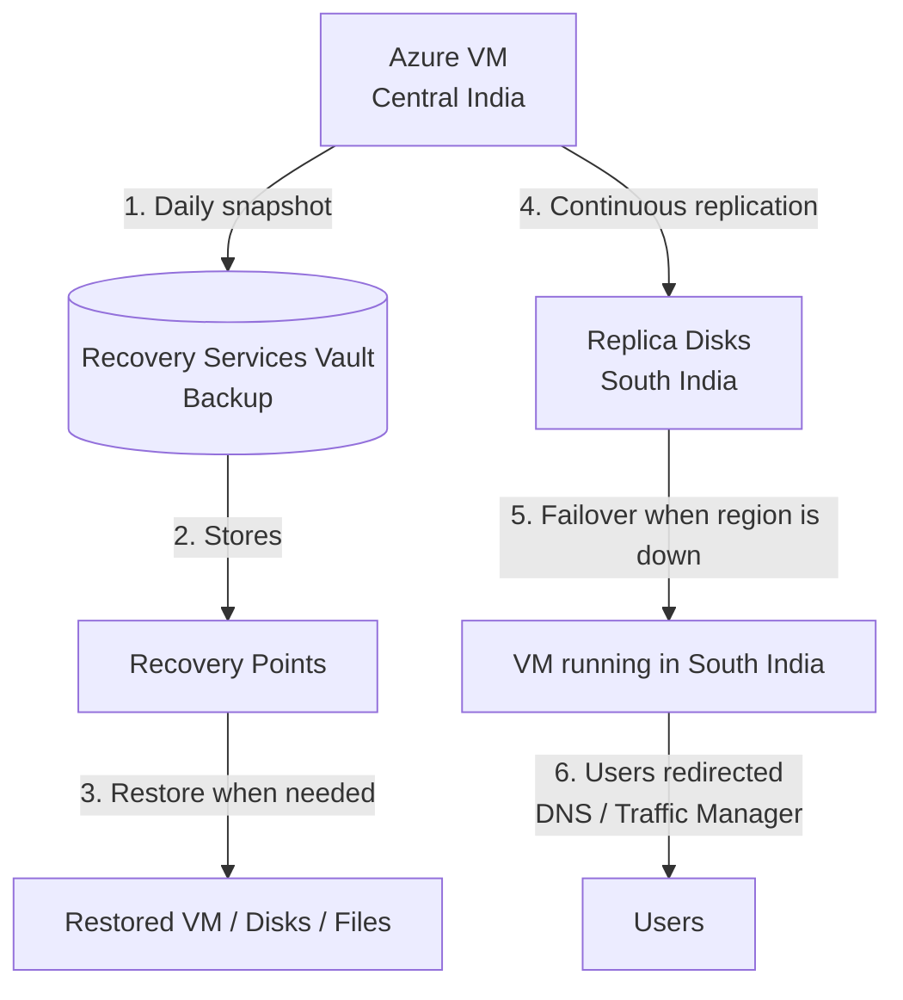

# Azure VM Backup and Disaster Recovery: Simple Flow

## 1. The Idea in One Line

- **Backup** = keep copies of your VM so you can **go back in time** (deleted file, bad patch, ransomware).
- **Disaster Recovery (DR)** = keep a copy of your VM in **another region** so you can **keep running** if the whole region goes down.

---

## 2. Simple Flow Diagram



### ASCII version (if Mermaid does not render)

```
                      BACKUP PATH
 +-----------+  daily   +-------------------+        +--------------------+
 | Azure VM  | -------> | Backup Vault      | -----> | Recovery Points    |
 | (Central  |          | (Recovery Services)|       +---------+----------+
 |  India)   |          +-------------------+                  |
 +-----+-----+                                                 | restore
       |                                                       v
       |  continuous        DR PATH                  +--------------------+
       |  replication                                | New VM / Disks /   |
       v                                             | Files              |
 +-----------------+  failover   +-----------------+ +--------------------+
 | Replica Disks   | ----------> | VM running in   | ---> Users (DNS switch)
 | (South India)   |             | South India     |
 +-----------------+             +-----------------+
```

---

## 3. Step-by-Step Explanation

### Backup path (steps 1 to 3)

| Step | What happens | Why |
|------|--------------|-----|
| 1 | Azure takes a **snapshot** of the VM disks on a schedule (for example daily) | Captures the VM at a point in time |
| 2 | Snapshot data is stored in the **Recovery Services Vault** as **recovery points** | Keeps history based on your retention policy (days, weeks, months) |
| 3 | When something goes wrong, you pick a recovery point and **restore** | Get back a full VM, only disks, or just a few files |

### Disaster recovery path (steps 4 to 6)

| Step | What happens | Why |
|------|--------------|-----|
| 4 | **Azure Site Recovery** continuously copies disk changes to **replica disks** in another region | Keeps data almost up to date (RPO of minutes) |
| 5 | If the primary region fails, you run **failover** and Azure creates the VM from the replica disks | Service comes back in minutes (low RTO) |
| 6 | You redirect users using **DNS, Traffic Manager or Front Door** | Users reach the VM in the new region |

After the original region recovers: **re-protect** (reverse replication), then **failback**, then re-protect again.

---

## 4. Restore Options (from a recovery point)

| Option | Result | Use when |
|--------|--------|----------|
| Create new VM | A fresh VM copy | VM deleted or you need a clone |
| Restore disks | Only the disks | You want to build the VM yourself |
| Replace existing | Current VM rolled back | Bad patch or corruption |
| File recovery | Individual files | One file was deleted |

---

## 5. Backup vs DR at a Glance

| | Backup | Disaster Recovery |
|---|--------|-------------------|
| Azure service | Azure Backup | Azure Site Recovery |
| Protects against | Delete, corruption, ransomware | Region or datacenter outage |
| Data copy | Point-in-time (history) | Near real-time replica |
| Recovery speed | Minutes to hours | Minutes |
| Cost | Lower | Higher |

> Use both: Backup for history, DR for availability.

---

## 6. Quick Setup Summary

**Backup**

1. Create a Recovery Services vault in the **same region as the VM**.
2. Choose storage redundancy (GRS recommended) before the first backup.
3. Choose a backup policy (schedule and retention).
4. Enable backup on the VM, then run **Backup now**.

**Disaster Recovery**

1. Create a Recovery Services vault in the **target region**.
2. On the VM, open **Disaster recovery** and choose the target region.
3. Enable replication and wait until it shows **Healthy**.
4. Run a **Test failover** regularly, then **Cleanup**.

**Permissions needed:** Backup Contributor, Virtual Machine Contributor, Site Recovery Contributor.

---

## 7. Use Cases

| Scenario | What to use |
|----------|-------------|
| VM deleted by mistake | Backup: restore new VM |
| A file was overwritten | Backup: file recovery |
| Bad patch breaks the VM | Backup: replace existing |
| Ransomware | Backup: restore an earlier recovery point |
| Region outage | DR: failover to the secondary region |
| Practice DR without downtime | DR: test failover |
