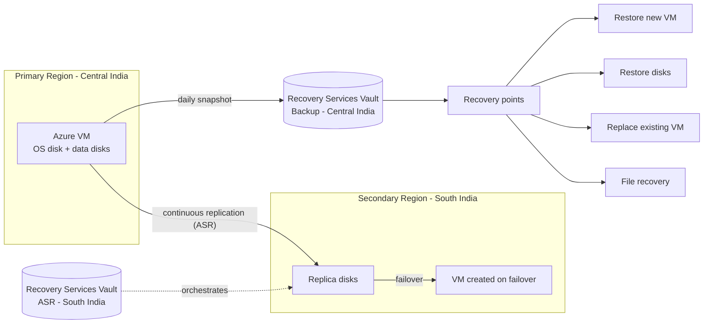
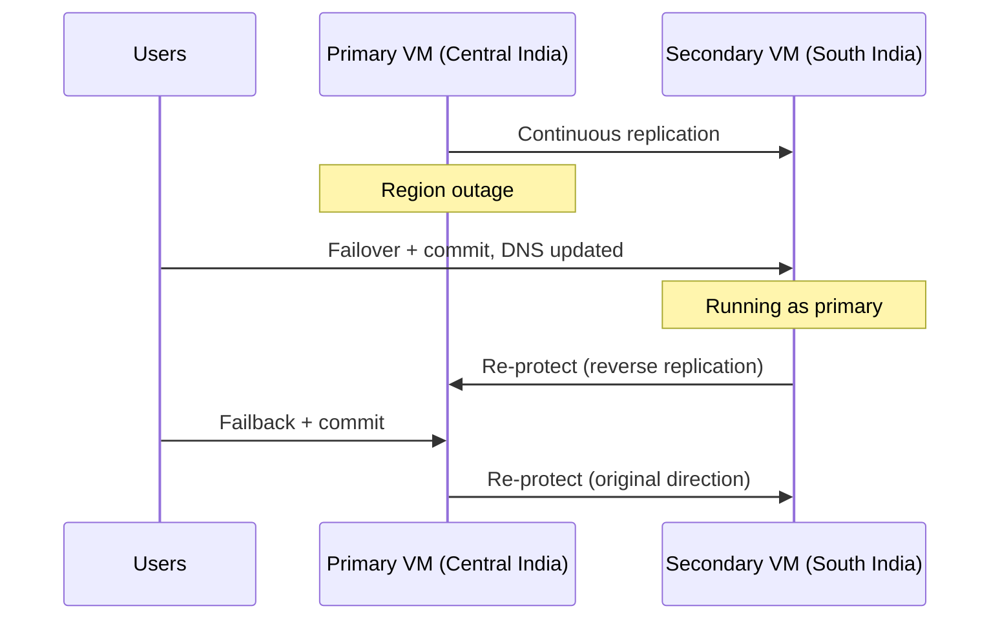

# Azure VM: Backup, Restore & Disaster Recovery (Step by Step)

This guide covers only **Azure Virtual Machines**: how to protect them with **Azure Backup**, restore them, and replicate them to another region with **Azure Site Recovery (ASR)**.

---

## 1. Overview

| Goal | Tool | Protects against |
|------|------|------------------|
| Recover VM / disks / files from a past point in time | **Azure Backup** | Accidental delete, corruption, ransomware, bad patch |
| Keep VM running from another region | **Azure Site Recovery** | Region or datacenter outage |



**How Azure Backup works for a VM**

1. A backup extension is installed on the VM automatically on first backup.
2. At the scheduled time, a **snapshot** of the disks is taken.
3. The snapshot data is transferred to the vault; an **instant restore** copy stays locally for a few days (1 to 5) for fast restore.
4. Each backup becomes a **recovery point**, kept per your retention policy.

---

## 2. Prerequisites (do these first)

### 2.1 Permissions

| Task | Role |
|------|------|
| Create vault, policy, enable backup | **Backup Contributor** (vault) |
| Enable backup on the VM | **Virtual Machine Contributor** (on VM) |
| Restore a VM | **Backup Operator** + **Virtual Machine Contributor** + **Network Contributor** on target RG/VNet |
| Configure replication / failover | **Site Recovery Contributor** |

```bash
az role assignment create \
  --assignee <user-or-object-id> \
  --role "Backup Contributor" \
  --scope /subscriptions/<sub-id>/resourceGroups/rg-vm-bcdr
```

### 2.2 Other requirements

- Azure subscription with providers registered:

```bash
az provider register --namespace Microsoft.RecoveryServices
az provider register --namespace Microsoft.Compute
az provider register --namespace Microsoft.Network
az provider register --namespace Microsoft.Storage
```

- **Backup vault must be in the same region as the VM.**
- **ASR vault must be in the target (DR) region.**
- VM must have outbound access to Azure (default works; with a firewall/NSG, allow the `AzureBackup` and `Storage` service tags).
- VM Agent must be running (Windows: Azure VM Agent, Linux: `waagent`).

---

## 3. (Optional) Create a Test VM

Use this to practice. Skip if you already have a VM.

```bash
RG=rg-vm-bcdr
LOC=centralindia
VM=vm-demo01

az group create -n $RG -l $LOC

az vm create \
  --resource-group $RG \
  --name $VM \
  --image Ubuntu2204 \
  --size Standard_B2s \
  --admin-username azureuser \
  --generate-ssh-keys \
  --public-ip-sku Standard
```

Add some test data so you can verify a restore later:

```bash
ssh azureuser@<public-ip>
echo "backup test file - v1" | sudo tee /home/azureuser/testfile.txt
```

---

## 4. Backup an Azure VM

### 4.1 Portal steps

1. **Create vault:** search **Recovery Services vaults** → **Create** → pick subscription, RG, name `rsv-backup-ci`, region **same as VM** → **Create**.
2. **Set redundancy** (before first backup): vault → **Properties → Backup Configuration → Update** → choose **Geo-redundant** (enable **Cross Region Restore**) or **Locally-redundant** → Save.
3. **Enable backup:** vault → **Backup** → *Where is your workload running?* **Azure** → *What to back up?* **Virtual machine** → **Backup**.
4. **Backup policy:** select **Default** or create a new one:
   - Frequency: Daily at a chosen time
   - Instant restore snapshot retention: 2 days
   - Daily retention: 30 days
   - Weekly: 12 weeks, Monthly: 12 months, Yearly: 3 years (example)
5. **Select VMs** (VM must be in same region) → **Enable backup**.
6. **Run first backup:** vault → **Backup items → Azure Virtual Machine → your VM → Backup now** → choose retention date → **OK**.
7. Watch progress in **Backup jobs**. Status should become **Completed**.

### 4.2 Azure CLI

```bash
RG=rg-vm-bcdr
LOC=centralindia
VAULT=rsv-backup-ci
VM=vm-demo01

# 1. Create vault
az backup vault create -g $RG -n $VAULT -l $LOC

# 2. Set GRS and Cross Region Restore (do before first protected item)
az backup vault backup-properties set \
  -g $RG -n $VAULT \
  --backup-storage-redundancy GeoRedundant \
  --cross-region-restore-flag true

# 3. List policies
az backup policy list -g $RG -v $VAULT -o table

# 4. Enable backup on the VM
az backup protection enable-for-vm \
  -g $RG -v $VAULT \
  --vm $VM \
  --policy-name DefaultPolicy

# 5. Run an on-demand backup
az backup protection backup-now \
  -g $RG -v $VAULT \
  -c $VM -i $VM \
  --backup-management-type AzureIaasVM \
  --retain-until 31-12-2026

# 6. Check jobs and recovery points
az backup job list -g $RG -v $VAULT -o table
az backup recoverypoint list -g $RG -v $VAULT -c $VM -i $VM \
  --backup-management-type AzureIaasVM -o table
```

### 4.3 Security settings (recommended)

- Keep **Soft delete** ON (deleted backups retained for 14+ days).
- Enable **Immutable vault** and **Multi-User Authorization**.
- Turn on **alerts** (backup failure) via Backup Center / Azure Monitor.

---

## 5. Restore an Azure VM

### 5.1 Choose the restore type

| Option | Result | Use when |
|--------|--------|----------|
| **Create new VM** | Brand-new VM from recovery point | VM deleted, or you want a copy/clone |
| **Restore disks** | Disks + template restored into a storage account; you build the VM | Need custom config or only a disk |
| **Replace existing** | Existing VM's disks replaced with the recovery point | Roll back in place after corruption |
| **File recovery** | Mount recovery point and copy files | Single file/folder lost |
| **Cross Region Restore** | Restore into paired region (GRS vault) | Primary region unavailable |

### 5.2 Restore as a new VM (Portal)

1. Vault → **Backup items → Azure Virtual Machine** → select the VM → **Restore VM**.
2. Pick a **Restore point** (use **Instant restore** points for fastest).
3. **Restore configuration:** *Create new* → set VM name, resource group, virtual network, subnet, and a **staging storage account**.
4. Click **Restore**. Track in **Backup jobs**.
5. When finished, open the new VM and verify data and connectivity.

### 5.3 Restore disks (CLI)

```bash
# Find a recovery point name
az backup recoverypoint list -g $RG -v $VAULT -c $VM -i $VM \
  --backup-management-type AzureIaasVM -o table

# Restore disks
az backup restore restore-disks \
  -g $RG -v $VAULT -c $VM -i $VM \
  --rp-name <recovery-point-name> \
  --storage-account <stagingstorageaccount> \
  --target-resource-group rg-vm-restore

# Track
az backup job list -g $RG -v $VAULT -o table
```

Then create a VM from the restored OS disk, or attach the restored data disk to an existing VM:

```bash
az vm disk attach -g $RG --vm-name $VM --name <restored-data-disk> 
```

### 5.4 Replace existing VM (in-place rollback)

1. **Restore VM → Restore configuration → Replace existing**.
2. Choose the recovery point and a staging storage account.
3. The VM is **stopped**, disks are swapped, then the VM starts again. A copy of the old disks is kept in the staging location temporarily.

### 5.5 File-level recovery

1. Vault → **Backup items → Azure Virtual Machine → your VM → File Recovery**.
2. Select a **recovery point** → **Download Executable** (Windows) or **Download Script** (Linux).
3. Run it on a machine that has access to the VM (Windows: run exe with the shown password; Linux: run the script as root).
4. The disks mount as drives/folders. **Copy the files you need.**
5. Click **Unmount Disks** in the portal when done (the mount expires after 12 hours).

### 5.6 Verify the restore

```bash
cat /home/azureuser/testfile.txt   # should show "backup test file - v1"
```

---

## 6. Disaster Recovery for an Azure VM (Azure Site Recovery)

### 6.1 Enable replication (Portal)

1. **Create a vault in the DR region:** Recovery Services vaults → **Create** → name `rsv-asr-south`, region **South India** (target).
2. Open the **source VM → Operations → Disaster recovery**.
3. **Basics:** Target region = **South India**.
4. **Advanced settings** (defaults are fine for a lab):
   - Target resource group, target virtual network, availability option
   - Cache storage account (in source region)
   - Replica disk type, replication policy (recovery point retention 24 h, app-consistent snapshot every 4 h)
5. Click **Review + Start replication**.
6. Wait until **Replication health: Healthy** and status **Protected**. Initial sync may take time depending on disk size.

### 6.2 Create a Recovery Plan (for multiple VMs)

1. ASR vault → **Recovery Plans → Create**.
2. Name, source region, target region, select VMs.
3. Group the VMs in order (for example Group 1: DB, Group 2: App, Group 3: Web).
4. Optionally add **pre/post actions** (Azure Automation runbooks, manual steps).

### 6.3 Test failover (do regularly, no impact on production)

1. Vault → **Replicated items → your VM → Test failover**.
2. Choose recovery point (**Latest processed** is common) and an **isolated test VNet**.
3. Click **OK**, then verify the VM boots and the app works in the target region.
4. Run **Cleanup test failover** to delete test resources.

### 6.4 Real failover

1. Vault → **Replicated items → your VM → Failover**.
2. Pick recovery point:
   - **Latest** (lowest data loss, takes longer)
   - **Latest processed** (faster)
   - **Latest app-consistent**
   - **Custom**
3. Optionally tick *Shut down machine before beginning failover*.
4. Click **OK** and wait until the VM is created and running in South India.
5. **Commit** the failover once validated.
6. Update DNS / Traffic Manager / Front Door to point to the new VM.

### 6.5 Re-protect and failback

1. After the primary region recovers: VM → **Re-protect** (reverses replication from South India → Central India).
2. When replication is healthy, run **Failover** again to return to Central India.
3. **Commit**, then **Re-protect** once more to restore the original direction.



---

## 7. Backup vs DR for a VM

| Feature | Azure Backup | Site Recovery |
|---------|--------------|---------------|
| Purpose | Restore data from a point in time | Run the VM in another region |
| Typical RPO | Hours (24 h default; lower with Enhanced policy) | Seconds to minutes |
| Typical RTO | Minutes to hours (depends on size) | Minutes |
| Retention | Days to years | Hours to 15 days |
| Cost | Lower | Higher (replica disks and cache) |
| Handles ransomware / delete | Yes | No (corruption is replicated too) |
| Handles region outage | Only with Cross Region Restore | Yes |

> Use **both**: Backup for history and ransomware recovery, ASR for fast regional failover.

---

## 8. Use Cases

| # | Scenario | What to use |
|---|----------|-------------|
| 1 | VM deleted by mistake | Restore as new VM |
| 2 | A bad patch or config breaks the VM | Replace existing VM |
| 3 | One file or folder deleted | File recovery |
| 4 | Need only the data disk | Restore disks, attach to another VM |
| 5 | Ransomware encrypts the VM | Restore from an earlier recovery point (immutable vault) |
| 6 | Central India region down | ASR failover (or Cross Region Restore) to South India |
| 7 | Create a dev/test copy of production | Restore as new VM in a test RG |
| 8 | Audit requires 1 to 7 years of retention | Backup policy with monthly/yearly retention |
| 9 | Validate DR readiness | Test failover with isolated VNet |
| 10 | Move VM to another region | Enable ASR, failover, commit, disable replication |

---

## 9. Troubleshooting Quick Reference

| Problem | Likely cause | Fix |
|---------|--------------|-----|
| VM not listed when enabling backup | VM in a different region than the vault | Create a vault in the VM's region |
| Backup fails: *UserErrorGuestAgentStatusUnavailable* | VM agent not running or no outbound access | Start the agent, allow `AzureBackup`/`Storage` tags |
| Backup fails: extension error | Extension in a bad state | Remove VM backup extension and retry |
| Cannot change vault redundancy | Items already protected | Set redundancy before first backup |
| Restore stuck / slow | Large disks or staging storage far away | Use a staging account in the same region |
| ASR replication status *Warning* | Cache storage or network issue | Check outbound connectivity to storage and Azure URLs |
| Failover VM has no network access | Target NSG/VNet not prepared | Pre-create target VNet/NSG, use recovery plan scripts |
| Cannot delete vault | Backup items, soft-deleted items, or ASR items remain | Disable protection with delete data, purge soft-deleted items |

---

## 10. Best Practices

1. Pick **RPO/RTO** per VM first, then choose Backup, ASR, or both.
2. Use **GRS + Cross Region Restore** for important VMs.
3. Keep **soft delete, immutability and MUA** enabled.
4. **Test restores and test failovers** on a schedule.
5. Use **Azure Policy** to automatically enable backup on new VMs.
6. Use **application-consistent** backups for databases (and pre/post scripts on Linux).
7. Monitor with **Backup Center**, **Azure Monitor** alerts and Log Analytics.
8. Tag VMs (for example `backup=daily`) to track coverage.
9. Document the **failover and failback runbook** and keep DNS/Traffic Manager steps in it.

---

## 11. Cleanup

```bash
# Stop protection and delete backup data
az backup protection disable -g $RG -v $VAULT -c $VM -i $VM \
  --backup-management-type AzureIaasVM --delete-backup-data true --yes

# Delete the vault
az backup vault delete -g $RG -n $VAULT --yes

# Delete the lab resource groups
az group delete -n $RG --yes --no-wait
az group delete -n rg-vm-restore --yes --no-wait
```

> For ASR, first **Disable replication** on the VM, then delete the DR vault and target resource group.

---

## 12. Summary

- **Backup:** vault → redundancy → policy → enable on VM → backup now.
- **Restore:** pick recovery point → new VM, disks, replace existing, or file recovery.
- **DR:** vault in target region → enable replication → recovery plan → test failover → failover → re-protect → failback.
